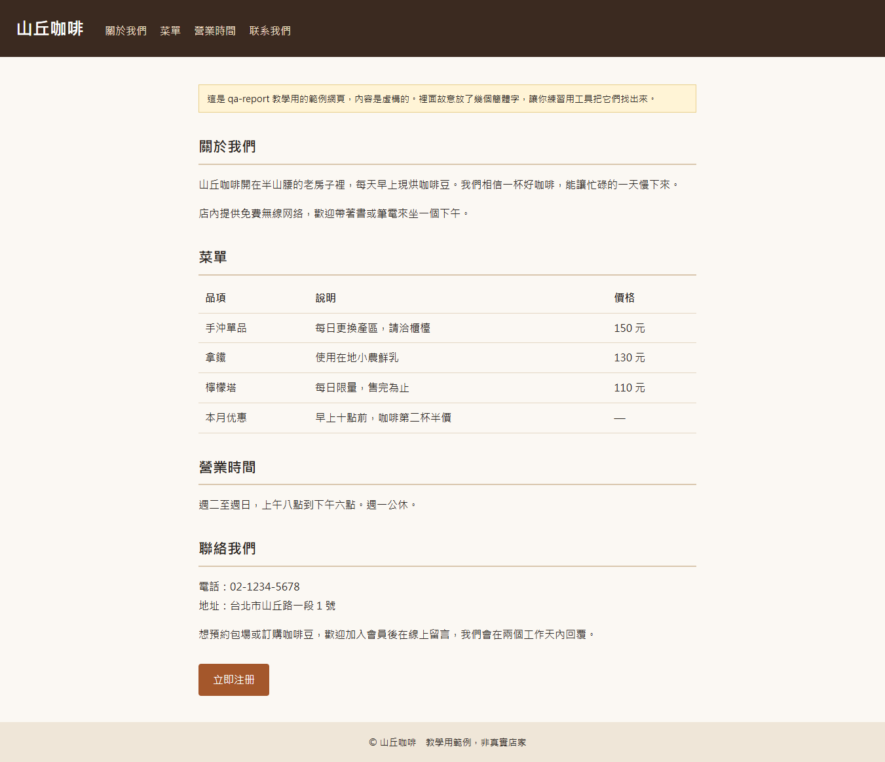

# qa-report：只測不修的 QA

給 Claude Code 用的 skill。給它網址和要檢查的事，它會開瀏覽器實際去看，交一份附截圖的報告。只看畫面，不讀原始碼，不改任何東西。

需要：Windows、Claude Code、Node 22 以上、Edge 或 Chrome。

## 教學：檢查網頁有沒有簡體字

### 第 1 步：下載

按綠色的 **Code** 按鈕，選 **Download ZIP**，解壓縮後把 `qa-report-main` 資料夾放到 C 槽或 D 槽。以下以 `D:\qa-report-main` 為例。

### 第 2 步：安裝

1. 用檔案總管打開 `D:\qa-report-main`（要看得到 `INSTALL.md` 的那一層），在網址列輸入 `cmd` 按 Enter。
2. 輸入 `claude` 按 Enter。
3. 輸入：`請閱讀 INSTALL.md，幫我安裝這個 skill`
4. 看到「安裝完成」就好了。放報告的資料夾 `QA-Workspace` 也會一起建好。


### 第 3 步：看一下要檢查的網頁

練習用的網頁是 `D:\qa-report-main\examples\demo-page\index.html`：



裡面有 4 處簡體字：

| 位置 | 網頁上寫的 | 繁體應該是 |
|---|---|---|
| 選單第四項 | **联**系我們 | 聯繫我們 |
| 「關於我們」第二段 | 免費無線**网络** | 免費無線網路 |
| 「菜單」最後一列 | 本月**优**惠 | 本月優惠 |
| 最下方的按鈕 | 立即注**册** | 立即註冊 |

## 要用的時候

### 開始測試

1. 用檔案總管打開 `D:\qa-report-main\QA-Workspace`，在網址列輸入 `cmd` 按 Enter，再輸入 `claude` 按 Enter。
2. 輸入指令。先用練習網頁試一次：

   ```
   /qa-report D:\qa-report-main\examples\demo-page\index.html 檢查這個網頁有沒有簡體字
   ```

   之後把網址和後面那句話換成你要的：

   ```
   /qa-report https://你的網站 檢查這個網頁有沒有簡體字
   /qa-report https://你的網站 測一下聯絡表單
   ```

### 看報告

點它回覆的連結：


報告都存在 `QA-Workspace\reports`，每測一次多一個資料夾：

```
D:\qa-report-main\QA-Workspace\
└─ reports\
   ├─ 20261117-103321-demo-page\
   │  ├─ 1_plan.md             測試前寫的計畫
   │  ├─ 2_screenshots\        截圖
   │  └─ 3_qa-report.html      報告，用瀏覽器打開
   └─ 20261118-141502-你的網站\
```

### 其他

- **要登入的網站**：它會跳出瀏覽器視窗讓你自己登入。
- **要參考的文件**：放進 `D:\qa-report-main\QA-Workspace\docs\`，在指令裡提到檔名。
- **請只用測試帳號和測試資料**：畫面和截圖會送給 AI 判斷。
- **不要搬動或刪除 `qa-report-main`**：報告存在裡面。搬動後要重新安裝；更新時用新檔案覆蓋即可。
